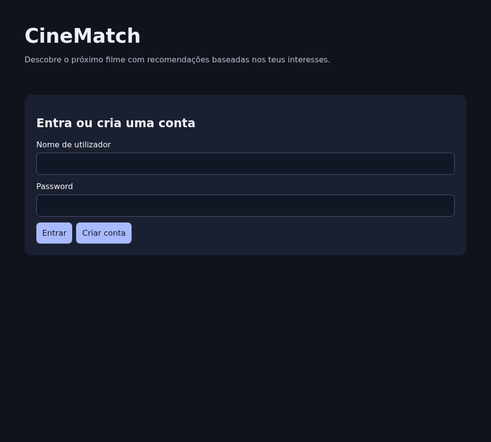
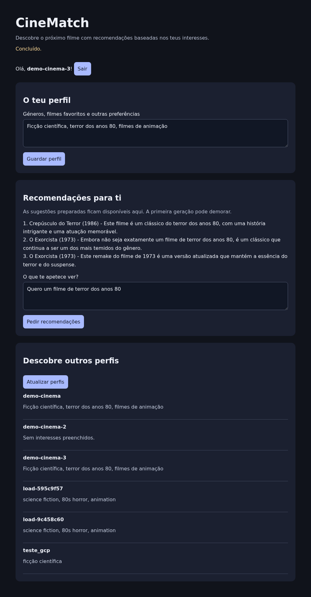
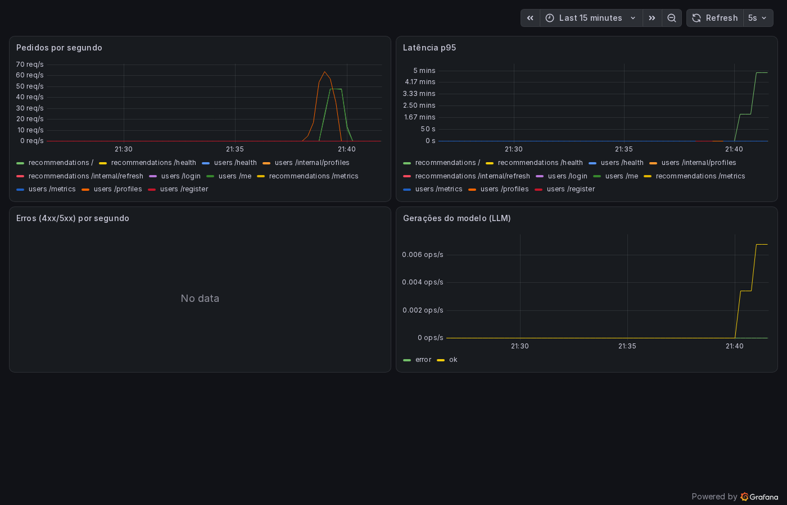

# CineMatch — PSIA, grupo 28

Aplicação de recomendações de filmes com inteligência artificial. Permite criar contas, iniciar sessão, guardar interesses, consultar perfis de outros utilizadores e pedir sugestões personalizadas. Um worker prepara recomendações em segundo plano. O modelo é executado no Ollama, sem treino próprio.

**Vídeo de demonstração:** https://youtu.be/9uU2pqx85WI

**Opção avançada implementada:** estado persistente (é possível parar todas as VMs e voltá-las a ligar sem perder dados; ver a secção 4). O relatório (`project-g28.pdf`) é entregue à parte, no Fenix.

O código encontra-se em [`project/`](project/). Existem duas formas de execução: Docker Compose no computador local e Kubernetes autogerido em máquinas virtuais da Google Cloud, instalado com Terraform e Ansible. Os requisitos originais estão no [enunciado](project/docs/enunciado.md).

## Arquitetura e decisões


| Componente | Implementação e responsabilidade |
| --- | --- |
| Frontend | HTML, CSS e JavaScript servidos por Nginx; encaminha pedidos para as APIs. |
| Utilizadores | Serviço Python para registo, login, sessões e perfis, com base SQLite própria. |
| Recomendações | Serviço Python que valida sessões pela API de utilizadores, chama o Ollama e guarda a última resposta por utilizador na sua própria base SQLite. |
| Worker | Processo Python que pede atualizações através de uma rota interna autenticada. |
| Inferência | Ollama: `qwen2.5:0.5b` por defeito no Compose e `qwen2.5:3b` na configuração Kubernetes atual. |
| Monitorização | Prometheus recolhe métricas dos serviços Python a cada 5 segundos; Grafana apresenta o dashboard CineMatch. |
| Infraestrutura | Terraform cria VMs e rede na GCP; Ansible instala containerd, Kubernetes com kubeadm, Flannel, armazenamento local e aplicação. Não usa GKE. |

Os dois serviços Python partilham código e imagem, mas executam separadamente, com bases e volumes distintos. O papel de cada processo é escolhido por `ROLE`. Usam apenas a biblioteca padrão do Python. A separação de dados evita acesso direto à base de outro serviço; SQLite simplifica esta implementação com uma réplica por serviço.

O navegador comunica com o Nginx. `/api/users/` segue para utilizadores e `/api/recommendations/` para recomendações. Dentro do Compose e do cluster, os componentes comunicam pelos nomes dos serviços.

As palavras-passe são processadas com scrypt e salt por conta. As sessões duram 24 horas. As rotas internas exigem `INTERNAL_KEY`; perfis públicos não incluem credenciais. As consultas SQL são parametrizadas e a interface apresenta dados através de `textContent`.

## Capturas de ecrã

| Início de sessão | Recomendações (qwen2.5:3b) | Dashboard Grafana |
| --- | --- | --- |
|  |  |  |

## 1. Executar localmente com Docker Compose

### Requisitos

- Git e Docker com motor de contentores Linux e Docker Compose disponíveis. No Windows, abrir Docker Desktop e esperar que esteja pronto.
- Internet para descarregar imagens e modelo, espaço em disco e memória suficiente. Inferência em CPU pode demorar.
- Python 3 apenas para os testes e ferramentas de verificação.

A partir da raiz do repositório, no PowerShell:

```powershell
cd project
if (!(Test-Path .env)) { Copy-Item .env.example .env }
```

Em Bash, o equivalente é:

```bash
cd project
if [ ! -f .env ]; then cp .env.example .env; fi
```

Editar `.env` e substituir `INTERNAL_KEY` por um segredo aleatório longo. `MODEL` escolhe o modelo. O `.env` é local e está ignorado pelo Git; não publicar o segredo.

```text
docker compose up -d --build
docker compose exec ollama ollama pull qwen2.5:0.5b
```

O comando `pull` deve usar exatamente o modelo definido em `.env`. O Compose não descarrega automaticamente os pesos. Não confundir a imagem do Ollama com os ficheiros do modelo. `depends_on` ordena o arranque, mas não garante que um serviço já esteja pronto.

| Endereço local | Utilização |
| --- | --- |
| http://localhost:8080 | CineMatch |
| http://localhost:9090/targets | Estado das recolhas do Prometheus |
| http://localhost:3000 | Grafana; abrir o dashboard CineMatch. Consulta anónima como Viewer ativada. |

Criar uma conta, guardar interesses e pedir uma recomendação. Criar outra conta para consultar perfis e testar isolamento. Para observar o worker, guardar interesses sem pedir sugestões, aguardar um ciclo e recarregar a página.

O worker renova respostas ausentes, com mais de 24 horas ou baseadas em interesses alterados. Espera 300 segundos após cada ciclo; a geração acrescenta tempo. Ler a cache não gera uma resposta nova e a página não consulta atualizações automaticamente. Uma falha para um utilizador não interrompe os restantes.

Comandos úteis, dentro de `project`:

```text
docker compose ps
docker compose logs --tail=100 users recommendations worker ollama
docker compose down
```

`down` mantém os volumes nomeados das bases de dados e modelos. Não usar `down -v` se pretender conservar esses dados.

## 2. Instalar na Google Cloud com Terraform e Ansible

Estes passos criam recursos na cloud. Usar Bash em Linux/WSL com Docker disponível. Os comandos de infraestrutura seguintes não são sintaxe PowerShell. Só o responsável pelo estado Terraform deve gerir a instalação existente.

### Pré-requisitos

1. Projeto GCP com faturação, Compute Engine API ativa e quotas suficientes para as VMs e IPs. A conta de serviço usada pelo Terraform precisa de permissões para os recursos de Compute Engine/rede definidos; o guia da infraestrutura usa Compute Admin. Ativar a API e configurar permissões antes da execução.
2. Guardar a chave JSON dessa conta em `~/.gcp/key.json`, fora do repositório.
3. Criar uma chave SSH dedicada, se ainda não existir:

```bash
mkdir -p ~/.gcp ~/.ssh
ssh-keygen -t ed25519 -f ~/.ssh/psia-gcp -N ""
chmod 600 ~/.gcp/key.json ~/.ssh/psia-gcp
```

O ficheiro JSON tem de ser colocado no caminho indicado antes do `chmod`; não é criado pelo comando `mkdir`. Não substituir uma chave SSH que já está a ser usada nas VMs.

4. Publicar as imagens da aplicação num registo acessível aos nós. Dentro de `project`, substituir `UTILIZADOR` pela conta Docker Hub e autenticar com `docker login`:

```bash
R=docker.io/UTILIZADOR/cinematch
docker build -t "$R:services-v1" -f services/Dockerfile .
docker build -t "$R:frontend-v1" -f frontend/Dockerfile .
docker push "$R:services-v1"
docker push "$R:frontend-v1"
```

Configurar `image_repo`, `services_tag` e `frontend_tag` em [group_vars/all.yml](project/infra/ansible/group_vars/all.yml) para corresponderem às imagens publicadas. O ficheiro inclui um repositório do grupo; confirmar a disponibilidade e a versão publicada antes de o reutilizar. Preferir tags novas quando o código da imagem muda.

### Criar as VMs

Dentro de `project`, abrir o ambiente de gestão:

```bash
bash infra/mgmt.sh
```

Este script constrói um contentor com Terraform, Ansible e SSH; monta o projeto e as chaves sem as incluir na imagem. Dentro dele, a pasta inicial é `/work/infra`:

```bash
cd terraform
terraform init
```

Criar `deployment.tfvars` nesta pasta, com os valores reais da instalação:

```hcl
project_id       = "O_TEU_PROJETO_GCP"
region           = "europe-west4"
zone             = "europe-west4-b"
worker_count     = 2
allowed_ssh_cidr = "O_TEU_IP_PUBLICO/32"
```

Os valores de máquina por defeito são `e2-medium` para o control plane e `e2-standard-2` para cada worker, com discos de 30 GB. Manter pelo menos um worker; o output da aplicação usa `worker1`. O exemplo usa a porta 30080: mantê-la consistente entre Terraform e `k8s/frontend.yaml` se for alterada. Autorizar em `allowed_ssh_cidr` as origens que vão administrar/testar o cluster.

```bash
terraform plan -var-file=deployment.tfvars
terraform apply -var-file=deployment.tfvars
terraform output node_ips
terraform output -raw frontend_url
```

O Terraform cria rede, sub-rede, regras de firewall, IPs estáticos e VMs Ubuntu. Gera também `infra/ansible/inventory.ini`. Guardar o estado Terraform local; não o publicar nem executar uma instalação concorrente a partir de outra cópia sem esse estado.

### Instalar Kubernetes e a aplicação

No mesmo contentor de gestão:

```bash
cd ../ansible
ansible all -m ping
ansible-playbook site.yml
```

A sequência é:

1. `01-nodes.yml`: configura Linux, containerd e pacotes Kubernetes.
2. `02-cluster.yml`: inicializa kubeadm, junta workers, instala Flannel e o provisionador `local-path`.
3. `03-app.yml`: copia os manifestos/configurações, gera a chave interna no cluster, aplica a aplicação e espera pelos Deployments.

Para imagens privadas, o playbook aceita `registry_username` e `registry_password` como variáveis externas e cria credenciais de leitura no cluster. Não guardar tokens em ficheiros versionados nem em comandos expostos; passar essas variáveis por um ficheiro local protegido, por exemplo `ansible-playbook site.yml -e @/CAMINHO/credenciais-locais.yml`.

### Verificar e abrir a aplicação

Fora do contentor de gestão, ligar por SSH usando o IP do master apresentado pelo Terraform:

```bash
ssh -i ~/.ssh/psia-gcp ubuntu@IP_MASTER
```

No master:

```bash
kubectl get nodes -o wide
kubectl -n cinematch get pods
kubectl -n cinematch get pvc
kubectl -n cinematch wait --for=condition=complete job/ollama-pull --timeout=900s
kubectl -n cinematch logs job/ollama-pull
```

Confirmar nós `Ready`, PVCs `Bound`, pods disponíveis e download concluído. O Job pode demorar e a disponibilidade do Deployment Ollama não garante que o modelo já esteja presente. Se falhar, consultar os logs antes de pedir recomendações.

Abrir o endereço `frontend_url`, normalmente `http://IP_WORKER:30080`. Os serviços internos comunicam por Services Kubernetes. O modelo configurado em [k8s/config.yaml](project/k8s/config.yaml) é `qwen2.5:3b`; o Ollama pede 2 GiB e tem limite de 4 GiB nesta instalação.

### Aceder a Prometheus e Grafana na cloud

Os serviços de monitorização não estão publicados como NodePort. Num terminal do computador local, criar o túnel:

```bash
ssh -i ~/.ssh/psia-gcp -L 3000:127.0.0.1:3000 -L 9090:127.0.0.1:9090 ubuntu@IP_MASTER
```

Dentro dessa sessão SSH, no master:

```bash
kubectl -n cinematch port-forward svc/grafana 3000:3000 >/tmp/cinematch-grafana-forward.log 2>&1 &
kubectl -n cinematch port-forward svc/prometheus 9090:9090 >/tmp/cinematch-prometheus-forward.log 2>&1 &
```

Manter a sessão aberta. No navegador local, abrir http://localhost:3000 e http://localhost:9090/targets. As portas locais devem estar livres, por exemplo sem o Compose local a ocupá-las. Os túneis têm de ser restabelecidos após parar o master.

O dashboard mostra pedidos por segundo, latência p95, erros HTTP e frequência de gerações. Inclui pedidos internos e recolhas de métricas. Não é, por si só, um teste de carga nem monitorização de CPU/memória das VMs.

## 3. Testes automáticos

A partir de `project`, com Python 3 e sem precisar de Docker ou credenciais cloud:

```text
python tests/smoke.py
python -m unittest discover -s tests -p "test_persistence_*.py"
```

O smoke test usa serviços HTTP reais com bases temporárias e um modelo simulado. Verifica autenticação, perfis, acesso interno, cache, isolamento, métricas e dados após reiniciar os dois serviços. Os outros testes simulam operações GCP/SSH e verificam as ferramentas de persistência sem parar VMs reais. Estes testes não avaliam a qualidade do modelo nem substituem a validação completa no navegador/cloud.

## 4. Opção avançada: persistência após parar todas as VMs

As bases SQLite e os modelos ficam em PVCs, servidos por armazenamento local nos discos dos nós. O objetivo é preservar o estado ao parar e voltar a ligar as mesmas VMs. Não existe replicação nem recuperação automática de um disco/nó eliminado.

As ferramentas estão divididas em:

| Ficheiro | Função |
| --- | --- |
| `tests/persistence.py` | Criar dados de ensaio e comparar conta, sessão, interesses e cache original. |
| `infra/persistence_vms.py` | Inspecionar, parar e arrancar as mesmas instâncias, verificando identidades e discos. |
| `tests/persistence_cycle.py` | Coordenar o ensaio, verificar recuperação Kubernetes e produzir um resumo. |

O ensaio completo altera o estado das VMs e deve ser executado de um computador externo ao cluster, com Python 3, SSH e CLI `gcloud` autenticada com permissões para consultar/parar/arrancar as instâncias. O contentor de gestão atual não inclui `gcloud`. No ambiente escolhido, autenticar a CLI e confirmar a conta/projeto antes de executar. Não gravar credenciais no repositório.

Dentro de `project`, substituir os valores pelos da instalação; a lista tem de conter todos os nós reais:

```text
python tests/persistence_cycle.py --url http://IP_WORKER:30080 --project PROJETO_GCP --zone europe-west4-b --nodes master worker1 worker2 --control-plane master --ssh ubuntu@IP_MASTER --ssh-key CAMINHO_CHAVE_PRIVADA --work-dir data/persistence/ensaio-01
```

Usar uma pasta nova por ensaio. A ferramenta pede uma palavra-passe sem a guardar em disco. Prepara uma conta e recomendação real, verifica o estado inicial, confirma todas as VMs `TERMINATED` e aplicação indisponível, volta a arrancá-las e compara nós, volumes e dados. Só anuncia `APROVADO` se todas as verificações passarem.

O resumo fica em `result.json` na pasta do ensaio. `persistence.json` contém o token original e deve permanecer privado; os ficheiros de `data/` são ignorados pelo Git. Completar o ensaio em menos de 24 horas e não editar o perfil ou gerar recomendações nessa conta antes da comparação. A expiração da sessão/cache pode invalidar a comparação sem provar perda de dados.

Se o ensaio parar antes de recuperar as VMs, consultar o erro e usar o inventário guardado para voltar a ligá-las:

```text
python infra/persistence_vms.py start --state data/persistence/ensaio-01/vms.json
```

O ensaio foi executado a sério no nosso cluster GCP (3 VMs, 18/10/2026, cerca de 6 minutos) e terminou com `APROVADO`: conta, sessão, interesses, recomendação em cache e login com a palavra-passe original ficaram idênticos, e os volumes eram os mesmos (mesmos UIDs e caminhos). Os testes simulados, por si sós, não provam o funcionamento na cloud; o resultado real está descrito no relatório.

## 5. Paragem, custos e limites

Teste de carga na cloud (detalhes no relatório): as leituras escalam linearmente até 16 clientes e saturam em cerca de 190 pedidos/s; o login (scrypt) é o caminho mais pesado e o serviço de utilizadores, com limite de memória de 256 MiB, falha com rajadas de logins.

- No Compose, `docker compose down` mantém as bases e os modelos nos volumes nomeados.
- Na cloud, parar VMs conserva os discos e permite o ensaio de persistência. Discos, endereços e outros recursos podem continuar a gerar custos.
- **`terraform destroy -var-file=deployment.tfvars` elimina a infraestrutura e pode eliminar os discos com os dados.** Executar apenas quando se pretende remover definitivamente os recursos, a partir do diretório Terraform e com o estado correto. Não usar no teste de persistência.
- O logout limpa o token no navegador; não o revoga no servidor. HTTPS e limitação de pedidos não estão configurados nesta solução.
- O modelo pode devolver sugestões incorretas; não existe validação contra um catálogo de filmes.
- Há uma réplica de cada serviço; não é uma implementação de alta disponibilidade ou escalabilidade automática.
- Prometheus/Grafana não têm armazenamento persistente do seu histórico configurado. A garantia de persistência demonstrada pelas ferramentas centra-se no estado funcional da aplicação e nos volumes originais.

## Organização

```text
project/
├── frontend/       # Página, Nginx e imagem do frontend
├── services/       # APIs Python, worker e imagem dos serviços
├── monitoring/     # Prometheus e dashboard/configuração Grafana
├── k8s/            # Manifestos da aplicação em Kubernetes
├── infra/          # Ambiente de gestão, Terraform, Ansible e operações das VMs
├── tests/          # Testes e ensaio de persistência
├── docs/           # Enunciado
├── compose.yaml    # Execução local
└── .env.example    # Exemplo de configuração local
```
